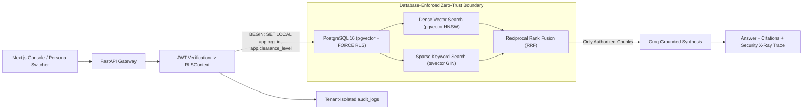

# EnclaveRAG

**Zero-Trust Multi-Tenant Enterprise RAG with Database-Enforced Clearance Control**

EnclaveRAG is a multi-organization Retrieval-Augmented Generation platform where both **tenant boundaries (`org_id`)** and **hierarchical "no read-up" clearance tiers (`L1`–`L4`)** are enforced inside **PostgreSQL (`pgvector` + Row-Level Security)**—before a single token ever reaches an LLM.

---

## Why EnclaveRAG?

Standard RAG demos fail real enterprise security requirements:
- **Prompt guardrails are bypassable:** Telling an LLM *"don't reveal executive secrets to interns"* fails under direct or indirect prompt injection.
- **Post-retrieval filtering hurts quality:** Dropping unauthorized chunks *after* `top-k` vector search leaves sparse or empty context for lower-clearance users.
- **Duplicated vector ACLs go stale:** Copying permissions into an external vector store requires expensive re-indexing whenever a document is reclassified.

**EnclaveRAG fixes all three at the database layer:**
1. **Zero-Trust PostgreSQL RLS:** Every request binds verified JWT claims via transaction-scoped `SET LOCAL` under a restricted `NOSUPERUSER NOBYPASSRLS` role (`enclave_app`) with `FORCE ROW LEVEL SECURITY`.
2. **$O(1)$ Reclassification:** Clearance metadata lives normalized on `documents`; upgrading a doc from `L2` to `L4` takes one row update with zero re-embedding.
3. **Hybrid Search Under RLS:** Combines `pgvector` HNSW cosine similarity (`hnsw.iterative_scan = relaxed_order`) and PostgreSQL `tsvector` keyword search via Reciprocal Rank Fusion (RRF).
4. **Existence-Leakage & Citation Protection:** Neutral fallback responses (`NO_ACCESSIBLE_INFO_MESSAGE`), citation suppression on empty/blocked answers, and an RLS-scoped `/documents/{id}/view` citation proxy.
5. **Security X-Ray UI:** Interactive Next.js console with live Persona Switching, Side-by-Side `L1 vs L4` comparison, one-click Prompt Injection Red-Teaming, and live $O(1)$ reclassification.

---

## Architecture



---

## Tech Stack

- **Database:** PostgreSQL 16 + `pgvector` + Row-Level Security (`FORCE ROW LEVEL SECURITY`)
- **Backend:** Python 3.11, FastAPI, `psycopg[binary,pool]`, `pyjwt`, `httpx`, `pypdf`
- **AI Providers:** Gemini `gemini-embedding-001` (`768`-dim Matryoshka embeddings) + Groq (`llama-3.3-70b-versatile`)
- **Frontend:** Next.js 15 (App Router), React, TypeScript, Tailwind CSS
- **Testing & CI:** `pytest`, `pytest-asyncio`, `ruff`, GitHub Actions (`pgvector/pgvector:pg16` service container)

---

## Repository Structure

```text
.
├── .github/workflows/ci.yml       # Automated lint, RLS tests, red-team suite & frontend build
├── docker-compose.yml             # PostgreSQL + pgvector container (host port 5433)
├── .env.example                   # Environment template
├── backend/
│   ├── app/
│   │   ├── api/routes.py          # Auth/personas, documents, /query, /view, /audit
│   │   ├── core/                  # Settings, AsyncConnectionPool + SET LOCAL, JWT auth
│   │   ├── ingestion/             # Text/PDF chunker, Gemini embedder, O(1) reclassification
│   │   ├── retrieval/             # Hybrid RRF search + citation proxy + audit logs
│   │   └── llm/synthesizer.py     # Groq grounded synthesis + prompt-injection defense
│   ├── db/
│   │   ├── migrations/            # 001_init_schema.sql + 002_rls_policies.sql
│   │   └── seed/seed_data.py      # Idempotent Apex Robotics & NovaFin Systems seed (L1-L4)
│   ├── evals/                     # Golden queries & Recall@5 / p95 latency benchmark runner
│   └── tests/                     # Unit, RLS integration, and security red-team suites
└── frontend/                      # Next.js Security X-Ray & Persona Switcher UI
```

---

## Quick Start

### 1. Configure Environment & Start PostgreSQL (`pgvector`)
```bash
cp .env.example .env
# Add your GEMINI_API_KEY and GROQ_API_KEY to .env
docker compose up -d db
```

### 2. Run Backend & Seed Synthetic Multi-Org Data
```bash
cd backend
python -m venv .venv
# Activate venv, then install:
pip install fastapi "uvicorn[standard]" pydantic-settings "psycopg[binary,pool]" pgvector pyjwt httpx python-multipart pypdf pytest pytest-asyncio ruff

python db/seed/seed_data.py
python -m app.main
```
Backend runs at `http://127.0.0.1:8000` (Swagger UI at `/docs`).

### 3. Run Frontend Console
```bash
cd frontend
npm install
npm run dev
```
Open **`http://localhost:3000`** to test:
- **Compare `L1` vs `L4`** on *"What is Project Helios?"*
- **Simulate Jailbreak** (indirect + direct prompt injection held at DB layer)
- **Live $O(1)$ Reclassification** in the Documents tab

---

## Verification & Benchmarks

```bash
cd backend
ruff check app tests db evals
pytest -v
python evals/run_eval.py --mode full
```

| Metric | Result |
| :--- | :--- |
| Automated Test Suite (`pytest -v`) | All unit, RLS integration & red-team tests passing |
| Cross-Tenant / Read-Up Leaks | `0` leaks |
| Retrieval `Recall@5` & `p95` Latency | Run `python evals/run_eval.py --mode full` to record local numbers |
