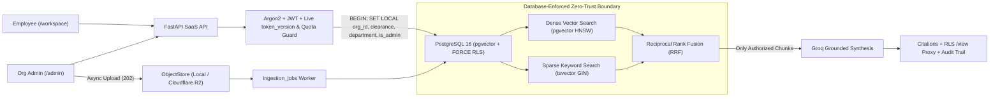

# EnclaveRAG

**Zero-Trust Multi-Tenant Enterprise RAG SaaS with Database-Enforced Clearance & ABAC Control**

EnclaveRAG is a multi-organization Retrieval-Augmented Generation platform where **tenant boundaries (`org_id`)**, **hierarchical clearance tiers (`L1`–`L4`)**, and **department ABAC** are enforced inside **PostgreSQL (`pgvector` + Row-Level Security)**—before a single token ever reaches an LLM.

---

## Key Capabilities

- **Database-Enforced Zero-Trust RLS & ABAC:** Every request verifies JWT claims (`token_version` checked live for instant revocation) and binds `app.org_id`, `app.clearance_level`, `app.department`, and `app.is_org_admin` via transaction-scoped `SET LOCAL` under a restricted `NOSUPERUSER NOBYPASSRLS` role (`enclave_app`).
- **Multi-Tenant SaaS Onboarding & Governance:** Organization registration (`/signup`), Argon2id login (`/login`), one-time SHA-256-hashed employee invite links (`/accept-invite`), Admin Console (`/admin`) for clearance updates and instant JWT revocation, and a clean Employee Workspace (`/workspace`).
- **$O(1)$ Reclassification:** Permissions live normalized on `documents`; reclassifying clearance (`L1`–`L4`) or department updates one row instantaneously with zero re-embedding.
- **Hybrid Search Under RLS:** Combines `pgvector` HNSW cosine similarity (`hnsw.iterative_scan = relaxed_order`) and PostgreSQL `tsvector` keyword search via Reciprocal Rank Fusion (RRF), plus Groq grounded synthesis and neutral anti-existence-leakage fallbacks.
- **Async Ingestion & S3-Compatible Storage (Tigris / R2):** Non-blocking `POST /api/v1/documents/upload-async` (`202 Accepted`) backed by `ingestion_jobs` and a pluggable `ObjectStore` (Local disk in dev; **Tigris** / Cloudflare R2 / S3 in production).
- **Quotas, Rate Limits & Billing Hooks:** Per-org `max_documents` and `monthly_query_limit` enforcement, sliding-window per-org rate limiting (`429 Retry-After`), and HMAC-SHA256-verified Stripe webhook updates.
- **Dev-Only Interactive Demo (`/demo`):** Persona Switcher, Side-by-Side `L1 vs L4` compare, and one-click Prompt Injection Red-Teaming (active in development for demos; disabled when `ENABLE_DEMO_MODE=false` / production builds).

---

## Architecture



---

## Tech Stack

- **Database:** PostgreSQL 16 + `pgvector` + `FORCE ROW LEVEL SECURITY` (`001`–`005` SQL migrations)
- **Backend:** Python 3.11, FastAPI, `psycopg[binary,pool]`, `pyjwt`, `pwdlib[argon2]`, `httpx`, `pypdf`, `boto3` (optional for R2)
- **AI Providers:** Gemini `gemini-embedding-001` (`768`-dim Matryoshka embeddings) + Groq (`llama-3.3-70b-versatile`)
- **Frontend:** Next.js 15 (App Router), React, TypeScript, Tailwind CSS
- **Testing & CI:** `pytest`, `pytest-asyncio`, `ruff`, GitHub Actions (`pgvector/pgvector:pg16`)

---

## Quick Start

### 1. Environment & PostgreSQL (`pgvector`)
```bash
cp .env.example .env
# Add GEMINI_API_KEY and GROQ_API_KEY to .env
docker compose up -d db
```
*(If upgrading an existing `enclave_db` volume, apply `003_saas_auth.sql`, `004_abac_rls.sql`, and `005_jobs_and_quotas.sql` via `psql`.)*

### 2. Backend Setup & Seed
```bash
cd backend
python -m venv .venv
# Activate venv, then install:
pip install fastapi "uvicorn[standard]" pydantic-settings "psycopg[binary,pool]" pgvector pyjwt "pwdlib[argon2]" httpx python-multipart pypdf pytest pytest-asyncio ruff
# Optional for Tigris / R2 / S3:
# pip install boto3

python db/seed/seed_data.py
python -m app.main
```
Backend runs at `http://127.0.0.1:8000` (`/docs` for Swagger UI).

### 3. Frontend Setup
```bash
cd frontend
npm install
npm run dev
```
Open **`http://localhost:3000`**:
- **`/signup`** — Onboard a new organization as an `L4` Org Admin
- **`/login`** — Sign in as an admin or invited employee *(seeded dev password: `EnclaveDemo123!`)*
- **`/workspace`** — Clean Employee Knowledge Assistant
- **`/admin`** — Team & Clearances, Invite Links, Async Tigris/Local Uploads, CSV Audit Export, Policy X-Ray
- **`/demo`** *(dev only)* — 1-click Persona Switcher & `L1 vs L4` Split Compare

---

## Verification & Benchmarks

```bash
cd backend
ruff check app tests db evals
pytest -v
python evals/run_eval.py --mode full
```

| Metric | Measured Result |
| :--- | :--- |
| Automated Test Suite (`pytest -v`) | **38 / 38 passed** (3.87s — unit, RLS, ABAC, auth, jobs/quotas & red-team) |
| Cross-Tenant / Read-Up Security Leaks | **0 / 9** (`0%` leak rate) |
| Retrieval `Recall@5` (across `L1`–`L4` positive cases) | **100.0%** (5 / 5) |
| Neutral Anti-Existence-Leakage Fallback Accuracy | **100.0%** |
| RLS-Filtered Hybrid Retrieval Latency (`p50` / `p95`) | **60.0 ms** / **72.0 ms** |
| End-to-End Query Latency incl. Gemini + Groq (`p50` / `p95`) | **2129.8 ms** / **2540.4 ms** |
